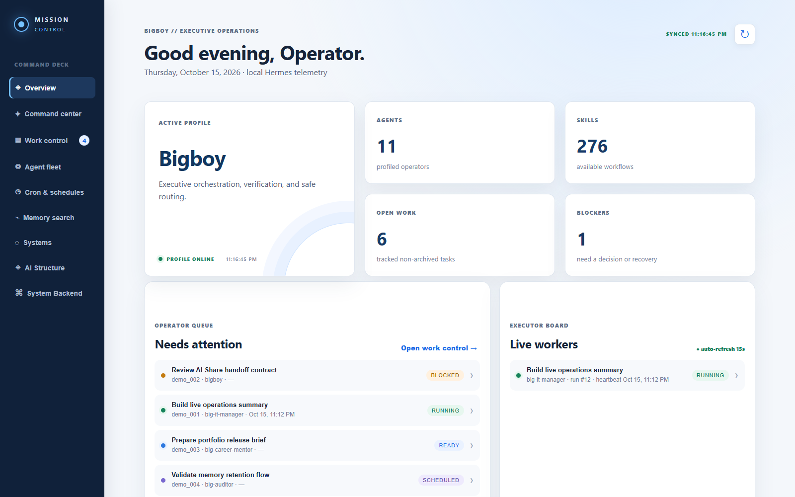

# AI Agent System Portfolio Demo

An interactive, local-preview mission-control dashboard for showcasing multi-agent coordination patterns in a GitHub portfolio. It is not a hosted service and does not require a live Hermes installation.

## Start with the portfolio showcase

Open [showcase.html](showcase.html) for the GitHub-friendly presentation. It includes the actual Archify diagrams as visible SVGs, the system story, the canonical task model, and links to the original interactive Archify sources. It is static by design, so it works on GitHub Pages without pretending to have a live backend.

## What this demo shows

- Executive overview with service health, blockers, queued work, and live worker evidence
- Kanban work control with task drawers, run history, event evidence, and `[user-input]` promotion to **Ready**
- Agent Fleet ordered by hierarchy: BigBoy, MiuMiu, managers, and specialists
- Cron and schedule cards with editable demo fields, enable/disable behavior, and simulated run-now feedback
- Memory search using seeded sample records
- Systems view with simulated CPU, RAM, GPU, and storage telemetry
- AI Structure with the canonical AI Share lanes: Inbox, Outbox, Status, and Results
- Embedded architecture diagrams with no connection to private files or production services

## Architecture gallery

### Mission Control product view



The screenshot is captured from the deterministic portfolio demo. It shows the operator-facing overview without exposing live Hermes tasks, credentials, local memory, or host telemetry.

The portfolio includes the actual Archify diagrams as SVG assets so GitHub renders the system visually in the repository. The original interactive Archify HTML is preserved beside each visual asset for local exploration.

### AI Share Agent Architecture


- [Open the interactive Archify source](references/ai-share-agent-architecture.html)

### Unified AI Systems Backend


- [Open the interactive Archify source](references/mission-control-unified-architecture.html)

The diagrams communicate the portfolio story at a glance: Dat Dao is the final authority, BigBoy is the Hermes executive orchestrator, MiuMiu is the external engineering orchestrator, and AI Share owns the canonical `task_id` state across Inbox, Outbox, Status, and Results.

## Preview locally

Requires Python 3.10+ and no third-party packages.

```powershell
python .\server.py
```

Open [http://127.0.0.1:8765/](http://127.0.0.1:8765/). The server is only a local preview helper; nothing is deployed or published by this project. The dashboard opens at the root because its API routes are intentionally local-first.

On Windows, you can also double-click `START_PORTFOLIO_DEMO.cmd` to preview it on port 8766.

To use another port:

```powershell
$env:MISSION_CONTROL_PORT = "8766"
python .\server.py
```

## Portfolio safety

This clone uses only in-memory demo data. It does not read Hermes, Mnemosyne, Obsidian, real cron stores, external delivery channels, credentials, user telemetry, or host resource counters. Changes made in the UI reset when the demo server restarts.

The `references/` HTML files preserve the interactive Archify diagrams; the extracted SVGs in `docs/diagrams/` are the GitHub-friendly visual presentation layer.

## Demo walkthrough

1. **Overview** — inspect service pulse, live-worker evidence, queued work, and blockers.
2. **Work control** — open a task to inspect runs and events; send an operator instruction to add `[user-input]` and promote open work to **Ready**.
3. **Cron & schedules** — edit demo fields, pause or enable a schedule, and use **Run now** to simulate a scheduler handoff.
4. **Agent fleet** — filter by status and open a profile to see hierarchy, assignments, cron jobs, skills, and runtime evidence.
5. **Memory search** — query seeded Mnemosyne-style records without touching a real memory store.
6. **Systems** — inspect simulated CPU, RAM, GPU, storage, gateway, and session cards.
7. **AI Structure / System Backend** — compare the canonical AI Share task lanes with the full backend architecture.
